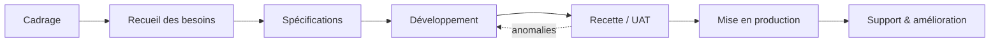
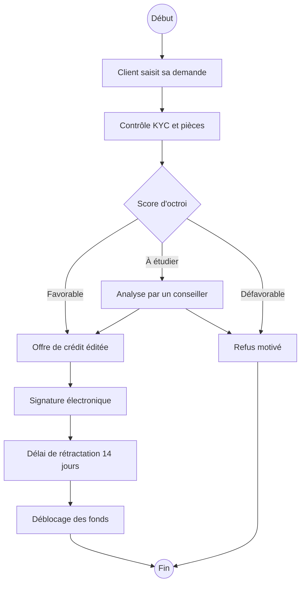

# Business Analysis & AMOA en banque-assurance

Guide de référence et cas pratique sur le métier de **Business Analyst (BA)** et l'**AMOA** appliqués aux secteurs **bancaire et assurantiel** : rôle, livrables, méthodes agiles, outils, connaissances métier et exemple de projet de bout en bout.

> Auteure : Fatma Hammami — Data Analyst, master en économie comportementale.
> Objectif : relier les compétences data (SQL, analyse, reporting) au métier de BA, qui fait le pont entre les directions métiers et les équipes IT.

---

## Sommaire

1. [MOA, MOE et AMOA](#1-moa-moe-et-amoa)
2. [Le rôle du Business Analyst](#2-le-rôle-du-business-analyst)
3. [Le cycle d'un projet](#3-le-cycle-dun-projet)
4. [Les livrables du BA](#4-les-livrables-du-ba)
5. [Agilité : Scrum et SAFe](#5-agilité--scrum-et-safe)
6. [Les outils](#6-les-outils)
7. [Connaissances métier banque](#7-connaissances-métier-banque)
8. [Connaissances métier assurance](#8-connaissances-métier-assurance)
9. [Risques et conformité](#9-risques-et-conformité)
10. [Cas pratique : digitaliser la souscription d'un crédit à la consommation](#10-cas-pratique--digitaliser-la-souscription-dun-crédit-à-la-consommation)
11. [SQL pour le Business Analyst](#11-sql-pour-le-business-analyst)
12. [Du data analyst au business analyst](#12-du-data-analyst-au-business-analyst)
13. [Glossaire](#13-glossaire)
14. [Auto-évaluation](#14-auto-évaluation)

---

## 1. MOA, MOE et AMOA

| Rôle | Qui ? | Ce qu'il fait |
|---|---|---|
| **MOA** — Maîtrise d'ouvrage | Le métier (direction épargne, crédit, sinistres…) | Exprime le besoin, porte le budget, valide le résultat |
| **MOE** — Maîtrise d'œuvre | L'IT (développeurs, architectes, testeurs) | Conçoit et construit la solution technique |
| **AMOA** — Assistance à maîtrise d'ouvrage | Le Business Analyst / consultant AMOA | Aide le métier à formaliser son besoin, le traduit pour l'IT, vérifie que la livraison correspond |

**En une phrase :** l'AMOA est l'interprète entre le métier, qui sait *ce qu'il veut*, et l'IT, qui sait *comment le construire*.

On distingue souvent :
- **Business Analyst** : focalisé sur l'analyse des besoins et les spécifications fonctionnelles.
- **Consultant AMOA** : rôle plus large, qui inclut le pilotage, la conduite du changement et l'animation des comités.
- **Product Owner** : en agile, responsable du backlog et des priorités ; le BA l'assiste souvent.

---

## 2. Le rôle du Business Analyst

Le BA intervient tout au long du projet :

- **Comprendre** le processus métier actuel (*as-is*) et le processus cible (*to-be*).
- **Recueillir** les besoins en ateliers et en entretiens avec les utilisateurs.
- **Formaliser** : spécifications fonctionnelles, user stories, règles de gestion, maquettes.
- **Prioriser** avec le métier (méthode MoSCoW : *Must, Should, Could, Won't*).
- **Accompagner** les développeurs : répondre aux questions, clarifier les règles.
- **Tester** : rédiger les cas de test, réaliser la recette fonctionnelle, suivre les anomalies.
- **Déployer** : former les utilisateurs, rédiger les guides, assurer le support après la mise en production.

**Compétences clés :** écoute, reformulation, rigueur rédactionnelle, esprit de synthèse, connaissance du métier, bases techniques (SQL, API, données).

---

## 3. Le cycle d'un projet



| Phase | Rôle du BA | Livrable |
|---|---|---|
| Cadrage | Comprendre le contexte, les objectifs, le périmètre | Note de cadrage |
| Recueil | Animer les ateliers, interviewer les utilisateurs | Expression de besoins, comptes rendus |
| Spécifications | Décrire précisément ce que le système doit faire | SFG / SFD, user stories, règles de gestion |
| Développement | Répondre aux questions de l'IT, affiner le backlog | Backlog à jour |
| Recette | Écrire et exécuter les tests, suivre les anomalies | Plan et cahier de recette, PV de recette |
| Mise en production | Préparer les utilisateurs | Guides utilisateur, formation |
| Support | Traiter les retours, proposer des évolutions | Backlog d'évolutions |

---

## 4. Les livrables du BA

### 4.1 Spécifications fonctionnelles

- **SFG** (générales) : vision d'ensemble, périmètre, acteurs, grands processus.
- **SFD** (détaillées) : écrans, champs, règles de gestion, cas d'erreur.

Une spécification décrit **ce que** le système doit faire, pas **comment** il le fait techniquement.

### 4.2 Règles de gestion

Exemple (crédit à la consommation) :

| ID | Règle |
|---|---|
| RG-01 | Le montant demandé doit être compris entre 1 000 € et 75 000 €. |
| RG-02 | La durée doit être comprise entre 12 et 84 mois. |
| RG-03 | Si le taux d'endettement après crédit dépasse 35 %, la demande est orientée vers un conseiller. |
| RG-04 | Un client fiché au FICP ne peut pas obtenir de réponse automatique favorable. |

### 4.3 User stories

Format : **En tant que** [utilisateur], **je veux** [action] **afin de** [bénéfice].

> **US-12 — Simulation de crédit**
> En tant que client connecté, je veux simuler un crédit en choisissant montant et durée, afin de connaître ma mensualité avant de faire une demande.
>
> **Critères d'acceptation (Gherkin) :**
> - **Étant donné** un client connecté sur la page de simulation,
> - **Quand** il saisit 10 000 € sur 48 mois,
> - **Alors** la mensualité, le TAEG et le coût total du crédit s'affichent.
>
> - **Étant donné** un montant saisi de 80 000 €,
> - **Quand** le client valide,
> - **Alors** un message indique que le montant maximum est de 75 000 € (RG-01).

Une bonne user story respecte **INVEST** : Indépendante, Négociable, Valorisable, Estimable, Small (petite), Testable.

### 4.4 Modélisation

- **BPMN** : schémas de processus métier (qui fait quoi, dans quel ordre, avec quelles décisions).
- **UML** : diagrammes de cas d'utilisation (acteurs et fonctionnalités), de séquence (échanges entre systèmes), d'activité.

Exemple de processus (simplifié, style BPMN) :



### 4.5 Recette et UAT

- **Recette fonctionnelle** : vérifier que chaque règle et chaque user story fonctionne.
- **UAT** (*User Acceptance Testing*) : les utilisateurs métiers valident que la solution répond à leur besoin.
- **Non-régression** : vérifier que l'existant fonctionne toujours.

Exemple de cas de test :

| ID | Prérequis | Étapes | Résultat attendu | Statut |
|---|---|---|---|---|
| CT-07 | Client avec revenus de 2 500 €/mois et 800 € de charges | Demande de 15 000 € sur 60 mois | Taux d'endettement > 35 %, orientation conseiller (RG-03) | OK / KO |

Les anomalies sont tracées (dans Jira) avec : étapes de reproduction, résultat obtenu, résultat attendu, gravité (bloquante, majeure, mineure).

---

## 5. Agilité : Scrum et SAFe

**Scrum**
- Travail en **sprints** de 2 à 3 semaines.
- **Rôles** : Product Owner (priorités), Scrum Master (méthode), équipe de développement.
- **Cérémonies** : sprint planning, daily (15 min), sprint review (démo), rétrospective.
- **Artefacts** : product backlog, sprint backlog, incrément.

**Place du BA en agile** : il rédige et affine les user stories (*backlog refinement*), précise les critères d'acceptation, participe aux démos et valide les livraisons.

**SAFe** (*Scaled Agile Framework*) : Scrum à grande échelle, courant dans les grandes banques. Plusieurs équipes sont regroupées dans un **ART** (*Agile Release Train*) et planifient ensemble lors du **PI Planning**, toutes les 8 à 12 semaines.

**Cycle en V** (méthode traditionnelle) : spécifications complètes au départ, puis développement, puis tests. Encore utilisé sur les projets réglementaires.

---

## 6. Les outils

| Outil | Usage pour le BA |
|---|---|
| **Jira** | Backlog, user stories, suivi des tickets et des anomalies |
| **Confluence** | Documentation : spécifications, comptes rendus d'ateliers, guides |
| **Postman** | Tester des API : envoyer une requête, vérifier la réponse (JSON) |
| **SQL** | Vérifier les données en base pendant la recette, analyser l'existant |
| **Draw.io / Visio / Bizagi** | Schémas BPMN et UML |
| **Excel / Power BI** | Analyses, suivi d'avancement, reporting de recette |

**Postman en bref** : une API reçoit une requête (méthode `GET`, `POST`, `PUT`, `DELETE`) et renvoie une réponse avec un code (`200` OK, `400` requête invalide, `401` non authentifié, `404` introuvable, `500` erreur serveur).

```http
POST /api/v1/credit/simulation
{
  "montant": 10000,
  "duree_mois": 48
}
```

---

## 7. Connaissances métier banque

### Épargne
- **Livrets réglementés** : Livret A, LDDS, LEP — taux fixé par l'État, sans risque.
- **PEL / CEL** : épargne logement.
- **Compte-titres et PEA** : investissement en actions.

### Crédit
- **Crédit immobilier** : long terme, garantie (hypothèque ou caution), assurance emprunteur.
- **Crédit à la consommation** : prêt personnel, crédit renouvelable, crédit affecté (auto).
- **Notions clés** :
  - **TAEG** : taux annuel effectif global, coût total du crédit en %.
  - **Taux d'endettement** : charges de crédit / revenus, souvent plafonné à 35 % (recommandation HCSF pour l'immobilier).
  - **Scoring d'octroi** : modèle qui évalue le risque de défaut d'un emprunteur.
  - **FICP** : fichier des incidents de remboursement, géré par la Banque de France.

### Moyens de paiement
- Cartes, virements (dont **SEPA** et **virement instantané**), prélèvements.
- **DSP2** : directive européenne sur les services de paiement (authentification forte, ouverture des données bancaires).

---

## 8. Connaissances métier assurance

### Assurance vie
- **Fonds en euros** : capital garanti, rendement modéré.
- **Unités de compte (UC)** : investies sur les marchés, plus risquées et sans garantie du capital.
- Opérations courantes : souscription, versement, arbitrage, rachat (partiel ou total), transmission aux bénéficiaires.

### Prévoyance
Protection en cas de **décès, invalidité, incapacité de travail** ou dépendance. Souvent en contrat collectif d'entreprise.

### Assurance dommages (IARD)
Incendie, accidents et risques divers : auto, habitation, responsabilité civile.

### Gestion des sinistres
1. Déclaration du sinistre par l'assuré.
2. Ouverture du dossier et vérification des garanties.
3. Expertise si nécessaire.
4. Indemnisation ou refus motivé.
5. Clôture du dossier.

### Indicateurs clés
- **Ratio sinistres / primes (S/P)** : part des primes consommée par les sinistres.
- **Ratio combiné** : (sinistres + frais) / primes. Au-dessus de 100 %, l'activité technique est déficitaire.
- **Taux de résiliation** : part des contrats résiliés sur la période.

---

## 9. Risques et conformité

| Sujet | En bref |
|---|---|
| **KYC** (*Know Your Customer*) | Identifier et connaître le client à l'entrée en relation et tout au long de celle-ci |
| **LCB-FT** | Lutte contre le blanchiment de capitaux et le financement du terrorisme |
| **RGPD** | Protection des données personnelles : consentement, minimisation, droit d'accès et d'effacement |
| **Bâle III / IV** | Exigences de fonds propres des banques selon leurs risques |
| **Solvabilité II** | Équivalent pour les assureurs |
| **Risque de crédit** | Risque que l'emprunteur ne rembourse pas |
| **Risque opérationnel** | Pertes liées à des erreurs, fraudes, défaillances de systèmes |
| **ACPR** | Autorité de contrôle prudentiel et de résolution, qui supervise banques et assurances en France |

Beaucoup de projets BA en banque sont **réglementaires** : une nouvelle règle impose d'adapter les systèmes avant une date fixe. Le BA traduit le texte réglementaire en exigences fonctionnelles.

---

## 10. Cas pratique : digitaliser la souscription d'un crédit à la consommation

**Contexte.** Une banque reçoit ses demandes de crédit en agence, sur papier. Délai moyen de réponse : 5 jours. Objectif : permettre une demande 100 % en ligne avec réponse de principe immédiate.

**1. Cadrage**
- Objectifs mesurables : délai de réponse < 24 h, 60 % des demandes en ligne à 1 an.
- Périmètre : prêt personnel de 1 000 € à 75 000 €. Hors périmètre : crédit immobilier.
- Parties prenantes : direction crédit, risques, conformité, conseillers, DSI.

**2. Recueil des besoins** (ateliers avec chaque partie prenante)
- *Métier* : simulateur, parcours court, suivi du dossier.
- *Risques* : scoring automatique, seuils de décision.
- *Conformité* : KYC, information précontractuelle obligatoire, délai de rétractation de 14 jours.
- *Conseillers* : reprise des dossiers « à étudier » dans leur outil.

**3. Backlog priorisé (MoSCoW)**

| Priorité | User story |
|---|---|
| Must | Simuler un crédit |
| Must | Déposer les pièces justificatives |
| Must | Obtenir une réponse de principe |
| Must | Signer électroniquement l'offre |
| Should | Suivre l'état du dossier en ligne |
| Could | Reprendre une demande abandonnée |
| Won't (v1) | Regroupement de crédits |

**4. Recette** : cas nominaux, cas limites (75 000 €, 84 mois), cas d'erreur (pièce illisible, client FICP), non-régression du parcours en agence.

**5. Indicateurs de succès après déploiement**
- Taux de conversion simulation → demande.
- Taux d'abandon à chaque étape du parcours.
- Délai moyen de réponse.
- Taux de dossiers orientés vers un conseiller.

---

## 11. SQL pour le Business Analyst

Le BA utilise SQL pour **vérifier les données pendant la recette** et **analyser l'existant**.

```sql
-- Vérifier que la règle RG-03 est respectée :
-- aucune demande avec un endettement > 35 % ne doit être acceptée automatiquement
SELECT d.id_demande,
       d.montant,
       d.mensualite,
       c.revenus_mensuels,
       ROUND((c.charges_mensuelles + d.mensualite) / c.revenus_mensuels * 100, 1) AS taux_endettement,
       d.statut
FROM demandes_credit d
JOIN clients c ON c.id_client = d.id_client
WHERE d.statut = 'ACCEPTEE_AUTO'
  AND (c.charges_mensuelles + d.mensualite) / c.revenus_mensuels > 0.35;
-- Résultat attendu : 0 ligne
```

```sql
-- Taux d'abandon par étape du parcours en ligne
SELECT etape,
       COUNT(*) AS nb_sessions,
       ROUND(100.0 * SUM(CASE WHEN abandon = 1 THEN 1 ELSE 0 END) / COUNT(*), 1) AS taux_abandon_pct
FROM parcours_souscription
GROUP BY etape
ORDER BY MIN(ordre_etape);
```

```sql
-- Ratio sinistres / primes par produit d'assurance
SELECT p.produit,
       SUM(s.montant_indemnise) AS sinistres,
       SUM(p.prime_annuelle)    AS primes,
       ROUND(100.0 * SUM(s.montant_indemnise) / SUM(p.prime_annuelle), 1) AS ratio_s_p
FROM contrats p
LEFT JOIN sinistres s ON s.id_contrat = p.id_contrat
GROUP BY p.produit;
```

---

## 12. Du data analyst au business analyst

| Compétence data | Équivalent BA |
|---|---|
| Comprendre la question métier avant d'analyser | Recueil et reformulation du besoin |
| Définir des KPI | Critères de succès et critères d'acceptation |
| Écrire du SQL, contrôler la qualité des données | Recette sur les données, tests de règles de gestion |
| Construire un dashboard pour un utilisateur | Conception centrée utilisateur, maquettes |
| Présenter des résultats à des non-techniciens | Animation d'ateliers et de comités |
| Économie comportementale (biais, usages) | Conception de parcours, réduction des abandons, conduite du changement |

---

## 13. Glossaire

| Terme | Définition |
|---|---|
| **As-is / To-be** | Processus actuel / processus cible |
| **Backlog** | Liste priorisée des fonctionnalités à réaliser |
| **BPMN** | Notation standard pour modéliser les processus métier |
| **Cahier de recette** | Ensemble des cas de test à exécuter |
| **Critères d'acceptation** | Conditions pour qu'une user story soit validée |
| **Gherkin** | Format *Étant donné / Quand / Alors* pour écrire des critères testables |
| **MEP** | Mise en production |
| **MoSCoW** | Méthode de priorisation : Must, Should, Could, Won't |
| **PI Planning** | Planification commune des équipes en SAFe |
| **PV de recette** | Document de validation formelle par le métier |
| **SFG / SFD** | Spécifications fonctionnelles générales / détaillées |
| **TAEG** | Taux annuel effectif global d'un crédit |
| **UAT** | Tests d'acceptation réalisés par les utilisateurs |
| **UML** | Langage de modélisation (cas d'utilisation, séquence, activité) |
| **User story** | Besoin exprimé du point de vue de l'utilisateur |

---

## 14. Auto-évaluation

1. Quelle est la différence entre MOA, MOE et AMOA ?
2. Que contient une SFD que ne contient pas une SFG ?
3. Rédigez une user story avec critères d'acceptation pour « un assuré déclare un sinistre en ligne ».
4. Quelle est la différence entre recette fonctionnelle et UAT ?
5. Que se passe-t-il lors d'un PI Planning ?
6. Fonds en euros ou unités de compte : lequel garantit le capital ?
7. Qu'est-ce que le KYC, et pourquoi est-il obligatoire ?
8. Un ratio combiné de 104 % : bonne ou mauvaise nouvelle ?
9. Un appel API renvoie un code 401 : que vérifiez-vous ?
10. Écrivez une requête SQL qui compte les sinistres ouverts depuis plus de 30 jours.

<details>
<summary>Éléments de réponse</summary>

1. MOA = métier qui exprime le besoin ; MOE = IT qui construit ; AMOA = interface qui formalise le besoin et vérifie la livraison.
2. Le détail des écrans, des champs, des règles de gestion et des cas d'erreur.
3. *En tant qu'assuré, je veux déclarer un sinistre en ligne afin d'être indemnisé plus vite.* Étant donné un contrat actif, quand je déclare un dégât des eaux avec photos, alors un numéro de dossier est créé et je reçois une confirmation.
4. La recette fonctionnelle vérifie la conformité aux spécifications ; l'UAT vérifie avec les utilisateurs que la solution répond au besoin réel.
5. Toutes les équipes d'un ART planifient ensemble les objectifs des 8 à 12 semaines suivantes et identifient leurs dépendances.
6. Le fonds en euros.
7. Identifier et connaître le client ; obligation réglementaire de lutte contre le blanchiment et le financement du terrorisme.
8. Mauvaise : l'assureur dépense plus en sinistres et frais qu'il ne perçoit de primes.
9. L'authentification : jeton manquant, expiré ou invalide.
10. ```sql
    SELECT COUNT(*) FROM sinistres
    WHERE statut = 'OUVERT'
      AND date_declaration < CURRENT_DATE - INTERVAL '30 days';
    ```

</details>

---

*Guide rédigé à des fins pédagogiques. Les seuils et règles cités dans le cas pratique sont des exemples illustratifs, à adapter à chaque établissement et à la réglementation en vigueur.*
