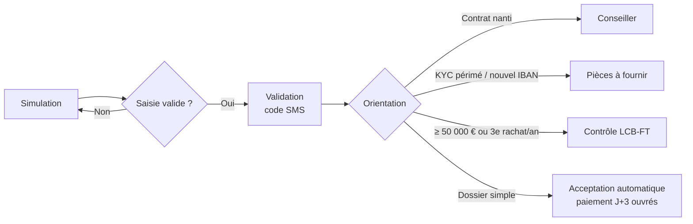

# Business Analyst / AMOA — Rachat partiel d'assurance vie en ligne

   

Projet portfolio qui reproduit **une mission complète de Business Analyst en assurance**, du cadrage au support après la mise en production : mettre en ligne la demande de **rachat partiel d'un contrat d'assurance vie**, avec les contrôles de **conformité LCB-FT** et de **risques**.

Chaque livrable correspond à une mission réelle du métier de BA / AMOA. Une **API de démonstration** implémente les règles de gestion pour montrer qu'elles sont précises, testables et vérifiées par la recette, avec Postman, SQL et des tests automatisés.

> Auteure : **Fatma Hammami** — Data Analyst / Business Analyst, master en économie comportementale.
> L'assureur « Assur'Vie Démo », les personas et les chiffres sont **fictifs**. Les seuils sont des paramètres illustratifs.

---

## Le problème métier

Aujourd'hui, un rachat se fait **par courrier** : 12 jours de délai en moyenne, 18 % de dossiers incomplets, ressaisie manuelle, et 40 % des appels au service client portent sur l'avancement.

**Objectif** : un parcours 100 % en ligne. Les dossiers simples sont payés en **3 jours ouvrés**. Les dossiers à risque (montant élevé, rachats fréquents, contrat nanti, KYC périmé, nouvel IBAN) sont **orientés automatiquement** vers le bon acteur.

## Missions de BA → livrables du projet

| Mission | Livrable |
|---|---|
| Cadrer le projet | [Note de cadrage](docs/01-cadrage/note-de-cadrage.md) : objectifs mesurables, périmètre, parties prenantes, planning, risques |
| Recueillir et formaliser les besoins auprès des directions métiers (épargne, risques, conformité) | [Comptes rendus des 3 ateliers](docs/02-recueil/comptes-rendus-ateliers.md) (avec un arbitrage Produit / Conformité) · [Expression de besoins MoSCoW](docs/02-recueil/expression-de-besoins.md) |
| Rédiger les spécifications fonctionnelles détaillées | [SFD](docs/03-specifications/sfd.md) : écrans, 11 règles de gestion, exemple chiffré, contrat d'API, matrice de traçabilité |
| Modéliser en BPMN et UML | [Processus as-is / to-be](docs/03-specifications/processus-bpmn.md) · [Cas d'utilisation, séquence, états, modèle de données](docs/03-specifications/uml.md) |
| Rédiger les user stories | [9 user stories en Gherkin](docs/03-specifications/user-stories.md) · [Backlog importable dans Jira](jira/backlog-import.csv) |
| Animer les comités de suivi | [Comité de suivi n°3](docs/04-pilotage/comite-de-suivi-sprint-3.md) : météo, vélocité, recette, risques, décisions |
| Définir la stratégie de recette | [Stratégie de recette](docs/05-recette/strategie-de-recette.md) : niveaux de test, personas, gestion des anomalies |
| Réaliser les tests fonctionnels et l'UAT | [Cahier de recette](docs/05-recette/cahier-de-recette.md) · [Tests automatisés](tests/test_recette.py) · [Collection Postman](postman/rachat-assurance-vie.postman_collection.json) · [Contrôles SQL](sql/controles_recette.sql) |
| Suivre les anomalies | [Registre des anomalies et PV de recette](docs/05-recette/anomalies-et-pv.md) |
| Accompagner les utilisateurs et assurer le support | [Plan d'accompagnement, guide gestionnaire, fiche service client, hypercare](docs/06-deploiement/accompagnement-et-support.md) |

## Le processus cible en un coup d'œil



## Règles de gestion

| ID | Règle |
|---|---|
| RG-01 | Contrat actif et détenu par le client connecté |
| RG-02 | KYC de moins de 36 mois, sinon justificatifs demandés |
| RG-03 | Montant minimum : 500 € |
| RG-04 | Encours restant ≥ 1 500 € |
| RG-05 | Répartition au prorata ou choisie, contrôlée par support |
| RG-06 | Contrat nanti → orientation vers un conseiller |
| RG-07 | ≥ 50 000 € ou 3e rachat sur 12 mois → contrôle LCB-FT |
| RG-08 | Nouvel IBAN → RIB à fournir |
| RG-09 | Calcul de la part de gains (estimation fiscale) |
| RG-10 | Paiement à J + 3 jours ouvrés (limite légale : 2 mois) |
| RG-11 | Authentification forte obligatoire pour valider |

## Lancer la démo

```bash
pip install -r requirements.txt

# Tests de recette automatisés (19 cas)
pytest -v

# API + documentation interactive sur http://127.0.0.1:8000/docs
uvicorn api.app:app --reload
```

Ensuite, dans **Postman** : importer `postman/rachat-assurance-vie.postman_collection.json` et lancer la collection avec le *Collection Runner*.

Pour les **contrôles SQL** : lancer l'API avec `RACHAT_DB=recette.db`, jouer la collection, puis exécuter `sql/controles_recette.sql` sur `recette.db`. Chaque contrôle doit renvoyer 0 ligne.

## Structure

```
├── docs/
│   ├── 01-cadrage/          note de cadrage
│   ├── 02-recueil/          ateliers, expression de besoins
│   ├── 03-specifications/   SFD, user stories, BPMN, UML
│   ├── 04-pilotage/         comité de suivi
│   ├── 05-recette/          stratégie, cahier de recette, anomalies, PV
│   └── 06-deploiement/      accompagnement et support
├── jira/                    backlog importable (CSV)
├── api/                     API de démonstration (FastAPI)
├── sql/                     schéma, personas, contrôles de recette et pilotage
├── postman/                 collection de recette API
├── tests/                   recette automatisée (pytest)
└── scripts/                 génération de la collection Postman
```

## Ce que ce projet montre

- **Faire le lien entre le métier et l'IT** : besoins métier → règles numérotées → contrat d'API → cas de test, avec une traçabilité complète.
- **Connaissance du domaine** : assurance vie (fonds en euros, unités de compte, valeur de rachat, part de gains), contrats nantis, LCB-FT, KYC, délai légal de paiement.
- **Rigueur de recette** : valeurs limites, personas, contrôles de données en SQL, analyse de la cause des anomalies (2 anomalies sur 3 venaient de la spécification).
- **Pilotage** : comités de suivi, météo projet, arbitrages documentés, indicateurs après la mise en production.
- **Regard comportemental** : choix de conception contre l'effet d'ancrage et la surprise fiscale (atelier 3).

**Outils** : Jira · Confluence (documentation en Markdown) · Postman · SQL · Python · BPMN / UML (Mermaid) · Scrum
