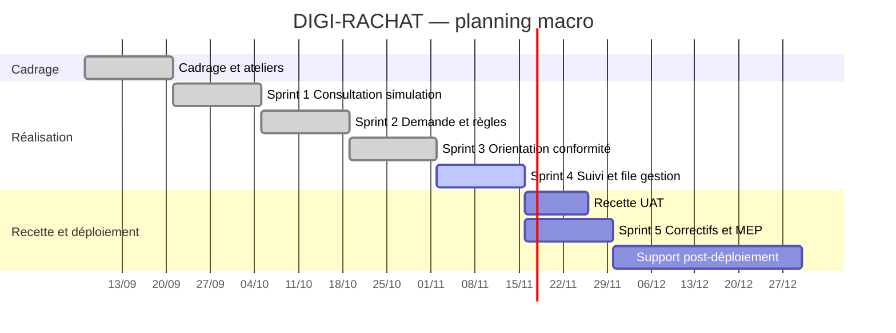

# Note de cadrage — Rachat partiel d'assurance vie en ligne

| | |
|---|---|
| **Projet** | DIGI-RACHAT — Digitalisation du rachat partiel |
| **Sponsor (MOA)** | Direction Épargne — Assur'Vie Démo (assureur fictif) |
| **Rédaction** | Fatma Hammami, Business Analyst AMOA |
| **Version** | 1.0 — validée en atelier de cadrage |
| **Méthode** | Scrum, sprints de 2 semaines |

---

## 1. Contexte

Aujourd'hui, un client qui veut récupérer une partie de son épargne investie en assurance vie doit envoyer un **formulaire papier** signé, accompagné d'un RIB et d'une pièce d'identité. Le gestionnaire ressaisit la demande dans l'outil de gestion des contrats.

**Constats remontés par le métier :**
- Délai moyen de traitement : **12 jours** entre l'envoi du courrier et le paiement.
- **18 %** des dossiers sont incomplets à réception (RIB manquant, signature absente), ce qui entraîne des relances.
- Environ **40 %** des appels au service client concernent l'état d'avancement d'un rachat.
- Les concurrents proposent déjà un parcours en ligne.

## 2. Objectifs

| Objectif | Indicateur | Cible à 12 mois |
|---|---|---|
| Réduire le délai de paiement | Délai demande → paiement | ≤ 3 jours ouvrés pour les dossiers automatiques |
| Supprimer la ressaisie | Part des demandes faites en ligne | ≥ 60 % |
| Automatiser le traitement simple | Taux d'acceptation automatique | ≥ 70 % des demandes en ligne |
| Réduire les appels | Appels « où en est mon rachat ? » | − 50 % |
| Rester conforme | Rachats acceptés à tort (contrôles SQL) | 0 |

## 3. Périmètre

**Dans le périmètre (v1)**
- Consultation de la valeur de rachat et du montant maximum autorisé.
- Simulation d'un rachat partiel : répartition par support, encours restant, part de gains.
- Demande en ligne avec authentification forte.
- Orientation automatique du dossier : acceptation, contrôle conformité, pièces à fournir, conseiller.
- Suivi de la demande dans l'espace client.
- File de travail des gestionnaires pour les dossiers non automatiques.

**Hors périmètre (v1)**
- Rachat total et clôture du contrat.
- Rachats partiels programmés (versements réguliers au client).
- Calcul de la fiscalité définitive (seule une estimation de la part de gains est affichée).
- Avances sur contrat.

## 4. Parties prenantes

| Acteur | Rôle dans le projet | Attentes principales |
|---|---|---|
| Direction Épargne | Sponsor, MOA, arbitre les priorités | Délai, satisfaction client, image |
| Product Owner (Épargne digitale) | Porte le backlog | Parcours simple, livraison rapide |
| Gestion des contrats (back-office) | Utilisateur final interne | Moins de ressaisie, dossiers complets |
| Conformité / LCB-FT | Valide les règles de contrôle | Aucun rachat suspect payé sans contrôle |
| Risques opérationnels | Valide les contrôles et la piste d'audit | Traçabilité, pas de paiement erroné |
| Fiscalité | Valide les informations fiscales affichées | Information exacte, pas de conseil fiscal |
| DPO | Valide le traitement des données | Conformité RGPD |
| DSI — équipe Front | MOE espace client | Spécifications claires, maquettes |
| DSI — équipe API Contrats | MOE services de gestion | Contrat d'interface, règles testables |
| Service client | Support après déploiement | Script d'appel, accès au suivi |

## 5. Contraintes

- **Réglementaire** : paiement au plus tard **2 mois** après la demande complète (article L132-21 du Code des assurances) ; obligations de vigilance LCB-FT ; RGPD.
- **Sécurité** : authentification forte du client avant toute opération financière.
- **Planning** : mise en production visée en fin de sprint 5, avant la campagne commerciale de janvier.
- **Technique** : réutiliser l'API du système de gestion des contrats existant.

## 6. Organisation et gouvernance

| Instance | Fréquence | Participants | Animation |
|---|---|---|---|
| Daily | Quotidien, 15 min | Équipe Scrum, BA | Scrum Master |
| Affinage du backlog | Hebdomadaire | PO, BA, développeurs | BA |
| Revue de sprint (démo) | Toutes les 2 semaines | Équipe, métier | PO / BA |
| **Comité de suivi projet** | Toutes les 2 semaines | Sponsor, PO, BA, Conformité, DSI | **BA** |
| Comité de pilotage | Mensuel | Direction Épargne, DSI | Chef de projet |

## 7. Planning macro

## 8. Risques identifiés au cadrage

| Risque | Probabilité | Impact | Action |
|---|---|---|---|
| Seuils LCB-FT non validés à temps par la Conformité | Moyenne | Fort | Atelier dédié dès la semaine 2, seuils paramétrables |
| Fraude au changement d'IBAN | Moyenne | Fort | Tout nouvel IBAN bascule en contrôle (RG-08) |
| Charge des gestionnaires sur les dossiers non automatiques | Moyenne | Moyen | File de travail dédiée, suivi du taux d'automatisation |
| Mauvaise compréhension de la fiscalité par les clients | Forte | Moyen | Libellés validés par la Fiscalité, mention « estimation » |
