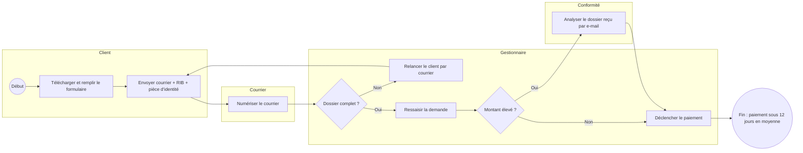
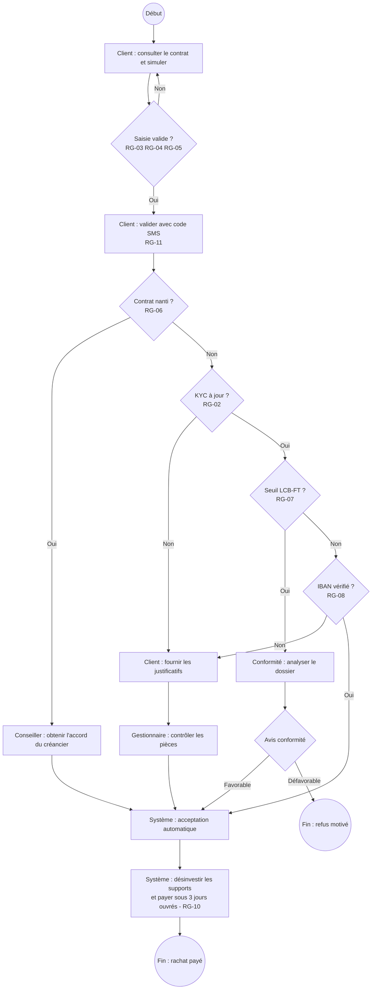

# Modélisation des processus (BPMN simplifié)

Les diagrammes ci-dessous suivent la logique BPMN : des couloirs par acteur, des tâches, des passerelles de décision et des événements de début et de fin. Ils sont rédigés en Mermaid pour être lisibles directement sur GitHub.

## Processus actuel (*as-is*)

**Points de rupture** : courrier (délai), dossiers incomplets (18 %), ressaisie (erreurs), échanges par e-mail avec la Conformité (pas de traçabilité).

## Processus cible (*to-be*)

**Gains attendus** : plus de courrier ni de ressaisie, dossiers complets dès la saisie, Conformité intégrée au flux avec un motif tracé, paiement en 3 jours ouvrés pour les dossiers simples.
