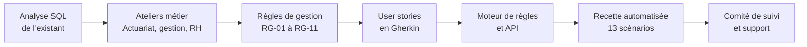

# Business Analyst / AMOA — Sinistres arrêt de travail en prévoyance collective

   

Projet portfolio qui reproduit une mission de **Business Analyst en assurance de personnes** : moderniser la déclaration et l'indemnisation des **arrêts de travail** couverts par un contrat de **prévoyance collective**.

Ce projet part **des données** : l'analyse SQL de 2 000 sinistres objective les irritants **avant** les ateliers. Il se termine par des **user stories exécutables** : les critères d'acceptation en Gherkin français sont joués automatiquement contre le moteur de règles.

> Auteure : **Fatma Hammami** — Data Analyst / Business Analyst, master en économie comportementale.
> Assureur, entreprises, salariés et chiffres **fictifs**. Paramètres de garantie illustratifs.

---

## La démarche



## Ce que l'analyse de données a montré

| Constat (2 000 sinistres de 2025) | Besoin qui en découle |
|---|---|
| **25 jours** entre la déclaration et le paiement, dont 13 jours d'instruction manuelle | Calcul automatique de l'indemnité |
| **36 %** de dossiers incomplets ; l'attestation de salaire de l'employeur manque dans 48 % des cas | Dépôt en ligne côté employeur, contrôle des pièces à la saisie |
| **82 %** des rejets concernent des arrêts sous la franchise de 30 jours | Contrôle d'éligibilité avant la déclaration |
| **2,9 %** d'erreurs de calcul en audit | Règles de calcul testées automatiquement |

→ [Analyse détaillée et gains estimés](docs/02-analyse-existant/analyse.md) · [Requêtes SQL](sql/analyse_existant.sql)

## Missions de BA → livrables

| Mission | Livrable |
|---|---|
| Cadrer le projet | [Note de cadrage](docs/01-cadrage/note-de-cadrage.md) |
| Analyser l'existant avec les données | [Analyse SQL de 2 000 sinistres](docs/02-analyse-existant/analyse.md) · [Résultats bruts](docs/02-analyse-existant/resultats-sql.md) |
| Recueillir et formaliser les besoins (prévoyance, actuariat, conformité, RH clientes) | [Ateliers et expression de besoins MoSCoW](docs/03-recueil/ateliers-et-besoins.md) |
| Rédiger les spécifications, modéliser le processus | [SFD : processus BPMN, 11 règles, exemples chiffrés, statuts, user stories](docs/04-specifications/sfd.md) |
| Écrire des critères d'acceptation testables | [Scénarios Gherkin exécutables](features/) |
| Recette et UAT | [Stratégie, couverture des règles, anomalies, UAT](docs/05-recette/recette.md) |
| Animer le comité de suivi, accompagner les utilisateurs | [Comité de suivi, accompagnement, hypercare](docs/06-pilotage/comite-de-suivi-et-support.md) |

## Exemple de scénario exécutable

```gherkin
Scénario: US-04 — Écrêtement quand l'employeur maintient une partie du salaire
  Étant donné un salarié affilié depuis le "01/04/2019" avec un salaire brut annuel de 36500 €
  Et des indemnités journalières de la Sécurité sociale de 41,47 € par jour
  Et un maintien de salaire par l'employeur de 10 € par jour
  Et un arrêt de travail du "01/09/2026" au "15/10/2026" déclaré le "10/09/2026"
  Et toutes les pièces obligatoires
  Quand le dossier est évalué le "06/11/2026"
  Alors le dossier est "ACCEPTE"
  Et l'indemnité est écrêtée
  Et l'indemnité journalière complémentaire est de 26,53 €
  Et 15 jours sont indemnisés pour un montant de 397,95 €
```

Le métier lit et valide ce texte, et `pytest` l'exécute. Si la règle change sans que le scénario suive, le test échoue.

## Lancer le projet

```bash
pip install -r requirements.txt

python scripts/generer_historique.py   # historique fictif de 2 000 sinistres
python scripts/analyser_existant.py    # analyse SQL -> docs/02-analyse-existant/resultats-sql.md
pytest -v                              # 13 scénarios Gherkin + 3 tests d'API
uvicorn api.app:app --reload           # API sur http://127.0.0.1:8000/docs
```

## Structure

```
├── docs/            cadrage, analyse de l'existant, ateliers, SFD, recette, pilotage
├── data/            historique fictif des sinistres 2025 (CSV)
├── sql/             requêtes d'analyse de l'existant
├── features/        user stories en Gherkin français (exécutables)
├── moteur/          moteur de règles (RG-01 à RG-11)
├── api/             API d'évaluation d'un sinistre (FastAPI)
├── tests/           exécution des scénarios et tests d'API
└── scripts/         génération des données et de l'analyse
```

## Ce que ce projet montre

- **Une BA qui s'appuie sur les données** : les priorités viennent de chiffres, pas d'impressions. Par exemple, 82 % des rejets étaient évitables.
- **Connaissance de la prévoyance** : IJSS, franchise, rechute, salaire de référence, écrêtement au net, durée maximale, contrôle médical.
- **Arbitrer avec des faits** : le rejet automatique des déclarations hors délai a été écarté, car un quart d'entre elles étaient finalement payées.
- **Des spécifications testables** : Gherkin exécutable, valeurs limites, anomalie de spécification détectée grâce aux scénarios.
- **Regard comportemental** : un message d'information plutôt qu'un blocage, et une liste de pièces avec barre de progression contre l'oubli.

**Outils** : SQL · Python · Gherkin / BDD · FastAPI · BPMN (Mermaid) · Scrum

**Voir aussi** : [projet épargne et conformité — rachat partiel d'assurance vie](../projet-ba-rachat-assurance-vie)
