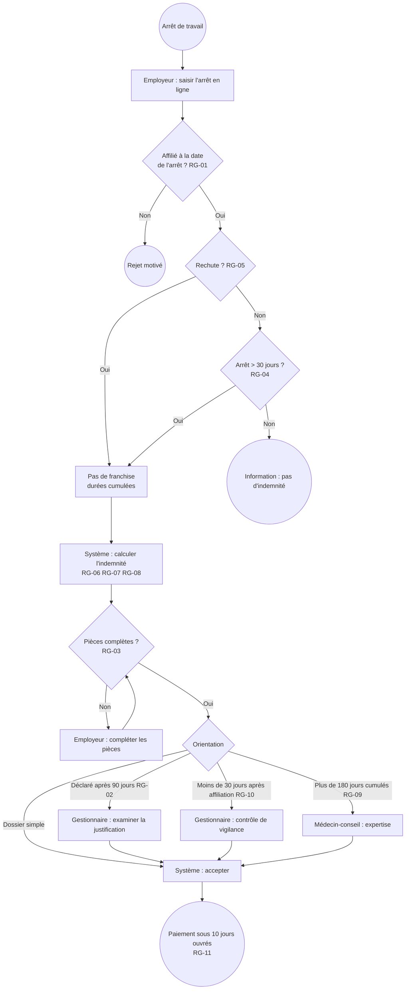

# Spécifications fonctionnelles détaillées (SFD)

| | |
|---|---|
| **Projet** | DIGI-AT — Sinistres arrêt de travail |
| **Version** | 1.1 (RG-08 précisée après ANO-02) |
| **Validation** | PO, Actuariat, médecin-conseil, Conformité |

## 1. Processus cible (BPMN simplifié)

## 2. Règles de gestion

Ordre d'application : **RG-01 → RG-05 → RG-04 → calcul (RG-06 à RG-08) → RG-03 → RG-02 → RG-10 → RG-09 → acceptation (RG-11)**. La première règle d'orientation qui s'applique détermine le statut.

| ID | Règle | Résultat |
|---|---|---|
| **RG-01** | Le salarié est affilié à la date de début de l'arrêt (date d'affiliation ≤ début, et pas de radiation avant le début). | Sinon **REJETE** |
| **RG-02** | La déclaration intervient au plus tard 90 jours après le début de l'arrêt. | Sinon **A_ETUDIER** |
| **RG-03** | Pièces obligatoires : arrêt de travail, attestation de salaire, décompte des IJSS. | Sinon **EN_ATTENTE_PIECES** + liste des pièces manquantes |
| **RG-04** | Franchise de 30 jours continus : seuls les jours à partir du 31e sont indemnisés. Un arrêt de 30 jours ou moins n'ouvre pas droit à indemnité. | **REJETE** (message d'information) |
| **RG-05** | **Rechute** : si l'arrêt a la même cause qu'un arrêt précédent et commence moins de 60 jours après sa fin, aucune nouvelle franchise ne s'applique, et les durées d'arrêt et d'indemnisation sont cumulées. | — |
| **RG-06** | Salaire journalier de référence (SJR) = salaire brut des 12 derniers mois / 365. Indemnité complémentaire = 75 % × SJR − IJSS (plancher 0). | — |
| **RG-07** | **Écrêtement** : IJSS + maintien employeur + complément ≤ salaire net de référence (78 % du SJR). Si dépassement, le complément est réduit. | — |
| **RG-08** | Durée maximale : 1 095 jours indemnisés, rechutes comprises. Les jours au-delà ne sont pas indemnisés. | — |
| **RG-09** | Arrêt cumulé de plus de 180 jours → expertise médicale. | **EN_CONTROLE_MEDICAL** |
| **RG-10** | Arrêt débutant moins de 30 jours après l'affiliation → contrôle de vigilance. | **CONTROLE_GESTIONNAIRE** |
| **RG-11** | Dossier accepté : paiement à J + 10 jours ouvrés après la décision. | **ACCEPTE** |

> Les paramètres (30 j, 60 j, 75 %, 78 %, 1 095 j, 180 j, 90 j) sont propres au contrat fictif et doivent être paramétrables par contrat.

## 3. Exemples de calcul

| Cas | SJR | IJSS | Maintien employeur | Complément (RG-06) | Plafond (RG-07) | Complément retenu |
|---|---|---|---|---|---|---|
| Sans maintien | 36 500 / 365 = **100,00 €** | 41,47 € | 0 € | 75,00 − 41,47 = **33,53 €** | 78,00 − 41,47 = 36,53 € | **33,53 €** |
| Avec maintien | 100,00 € | 41,47 € | 10 € | 33,53 € | 78,00 − 41,47 − 10 = **26,53 €** | **26,53 €** (écrêté) |

**Arrêt du 03/08 au 02/10/2026** : 61 jours − 30 jours de franchise = 31 jours × 33,53 € = **1 039,43 €**. Décision le 06/11 → paiement prévu le **20/11/2026** (J + 10 ouvrés ; les jours fériés ne sont pas gérés dans la démo).

**Rechute** : arrêt de 20 jours, même cause, 40 jours après la reprise → pas de franchise → 20 × 33,53 € = **670,60 €**.

## 4. Statuts et files de travail

| Statut | File | Message à l'employeur |
|---|---|---|
| ACCEPTE | — | « Indemnité de {montant} € acceptée, paiement prévu le {date}. » |
| EN_ATTENTE_PIECES | Employeur | « Pour finaliser : {pièces manquantes}. » |
| A_ETUDIER | Gestionnaire | « Votre déclaration est en cours d'examen. » |
| CONTROLE_GESTIONNAIRE | Gestionnaire | « Votre déclaration est en cours d'examen. » |
| EN_CONTROLE_MEDICAL | Médecin-conseil | « Une expertise médicale va être organisée. Le salarié sera contacté directement. » |
| REJETE | — | Motif explicite (non-affiliation, franchise) |

> Le motif de vigilance (RG-10) n'est jamais affiché à l'employeur.

## 5. User stories

| ID | User story | Règles | Scénarios exécutables |
|---|---|---|---|
| US-01 | En tant qu'employeur, je veux savoir avant de déclarer si l'arrêt peut être indemnisé, afin d'éviter un dossier inutile. | RG-01, RG-04 | [orientation.feature](../../features/orientation.feature) |
| US-02 | En tant qu'employeur, je veux être alerté des pièces manquantes à la saisie, afin d'envoyer un dossier complet du premier coup. | RG-03 | [orientation.feature](../../features/orientation.feature) |
| US-03 | En tant qu'employeur, je veux remplir l'attestation de salaire en ligne, afin de ne plus la remplir à la main. | — | Recette manuelle (écran) |
| US-04 | En tant que gestionnaire, je veux un calcul automatique de l'indemnité, afin de supprimer les erreurs. | RG-06, RG-07, RG-11 | [indemnisation.feature](../../features/indemnisation.feature) |
| US-05 | En tant que gestionnaire, je veux que les rechutes et la durée maximale soient gérées automatiquement, afin d'appliquer le contrat sans calcul manuel. | RG-04, RG-05, RG-08 | [indemnisation.feature](../../features/indemnisation.feature) |
| US-06 | En tant que responsable sinistres, je veux une orientation automatique des dossiers, afin que chaque dossier arrive dans la bonne file. | RG-02, RG-09, RG-10 | [orientation.feature](../../features/orientation.feature) |
| US-07 | En tant qu'employeur, je veux suivre l'avancement et la date de paiement, afin de prévenir mon salarié. | — | Recette manuelle (écran) |

## 6. Interface

`POST /sinistres/evaluation`. Elle reçoit les dates, le salaire, les IJSS, le maintien employeur, les pièces et l'arrêt précédent, et renvoie le statut, les règles appliquées, le détail du calcul et la date de paiement. La documentation interactive est disponible sur `/docs` une fois l'API lancée.
